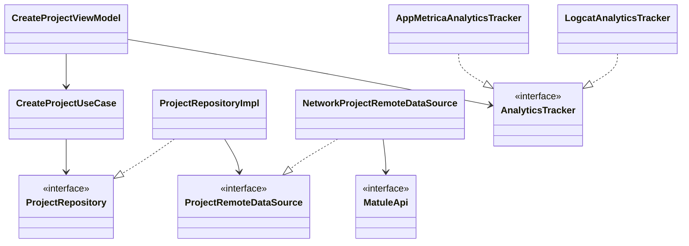

# Matule — презентация для разработчиков

Слайды-заготовка. Переносится в PowerPoint/Google Slides как есть: каждый `##` — один слайд.
Места для скриншотов помечены **[СКРИН]**.

---

## 1. Титул

**Matule** — магазин описаний для машинного вязания и проекты пользователя.
Тренировка по КЗ «Профессионалы-2026», компетенция «Разработка мобильных приложений».
Android, minSdk 33, Jetpack Compose.

## 2. Что сделано

- Три отдельных Gradle-проекта в одном репозитории:
  - **MatuleUIKit** — библиотека компонентов + демо-приложение со всеми состояниями;
  - **MatuleNetwork** — сетевая библиотека (клиент, запросы, модели, ошибки);
  - **Matule** — приложение, использует обе библиотеки через абстракции.
- Бэкенд — PocketBase (REST API): миграции со схемой, сид-данные, хук выхода.
- Все экраны из макета Figma: авторизация → PIN → главная/каталог/корзина/проекты/профиль.

**[СКРИН: дерево репозитория]**

## 3. Архитектура приложения

Clean Architecture, правило зависимостей `presentation → domain ← data`:

```
┌──────────────────────────── PRESENTATION ───────────────────────────┐
│  Compose-экраны → ViewModel (StateFlow<UiState> + одноразовые события) │
│        │ только use case'ы                                            │
├────────▼──────────────────── DOMAIN ────────────────────────────────┤
│  model / repository (интерфейсы) / usecase / validation               │
│  чистый Kotlin, без android.*                                         │
├────────▲──────────────────── DATA ──────────────────────────────────┤
│  remote: *RemoteDataSource (интерфейсы) + адаптеры к MatuleNetwork    │
│  local: DataStore (сессия, PIN, черновики, последний экран), кэш JSON │
│  repository: *RepositoryImpl                                          │
└─────────────────────────────────────────────────────────────────────┘
```

MVVM в слое представления (в методичке рекомендован MVP — для Compose стандарт индустрии MVVM).
DI — ручной контейнер `AppContainer` (одиночки lazy, use case'ы фабричные).

## 4. Схема классов (ключевые связи)



Остальные экраны повторяют тот же шаблон: `ViewModel → UseCase → Repository(интерфейс) → RemoteDataSource(интерфейс) → MatuleApi`.

## 5. Почему сеть заменяема

- Библиотека наружу отдаёт только интерфейсы (`MatuleApi`, сервисы) и фабрику `MatuleNetwork.create(...)`; реализации `internal`.
- В приложении сеть видна только через свои интерфейсы `*RemoteDataSource`; адаптер `Network*RemoteDataSource` — единственное место, знающее про библиотеку.
- Замена Retrofit-библиотеки на любую другую = переписать адаптеры в `data/remote`, остальной код не меняется.

## 6. Библиотеки и почему именно они

| Библиотека | Где | Почему |
|---|---|---|
| Jetpack Compose + Material3 | UI | Декларативный UI, единый подход во всех проектах |
| Navigation Compose | навигация | Типобезопасные маршруты, восстановление последнего экрана |
| Retrofit + OkHttp + kotlinx.serialization | внутри MatuleNetwork | Стандарт индустрии; спрятан за интерфейсами |
| Coil | картинки | Загрузка + дисковый кэш (кэш главной) |
| DataStore Preferences | сессия, PIN, черновики | Асинхронное хранение без SQLite |
| WorkManager | уведомления о неактивности | Гарантированная отложенная задача, переживает перезапуск |
| androidx.biometric | вход по биометрии | Системный BiometricPrompt |
| android.graphics.pdf.PdfRenderer | политика конфиденциальности | PDF без сторонних библиотек |
| AppMetrica SDK | аналитика | Требование задания (Яндекс-метрика) |
| JUnit + MockWebServer | тесты | Валидаторы, маппинг ошибок сети |

Hilt/KSP не использовались: ручной DI-контейнер прозрачнее для экспертной проверки и не требует кодогенерации.

## 7. UIKit

- Тема через `CompositionLocal`: `MatuleColors` (12 токенов), `MatuleTypography` (17 стилей), `MatuleSpacing` (4–48).
- Иконочный шрифт `matule_icons.ttf` (собран из SVG макета), коды в `object MatuleIcons`.
- Компоненты: Input (все состояния + маска даты), Select + BottomSheet, Search, кнопки Big/Small/Chips/Cart/LoginWith/Bubble, TabBar, карточки (товар/корзина/проект), Header, Toggle, Counter, SnackBar, PIN-клавиатура.
- У каждого компонента KDoc: описание + `@param` на каждый параметр.
- Showcase-приложение: все компоненты во всех состояниях с подписями.

**[СКРИН: showcase, 2–3 секции]**

## 8. Хранение и офлайн

- Сессия и токен — DataStore, переживают перезапуск; вход по PIN/биометрии.
- PIN — хэш с солью, в открытом виде не хранится.
- Кэш главной (акции + каталог) — JSON-файл: показываем сразу, потом обновляем с сервера; без сети работаем на кэше.
- Черновики «Создание профиля» и «Создание проекта» переживают перезапуск.
- Последний открытый экран восстанавливается после перезапуска.

## 9. Аппаратные расширения

- Фото проекта: BottomSheet «Галерея / Камера» — PhotoPicker или TakePicture + FileProvider.
- Локальные уведомления: нет активности в проекте > 3 минут; приложение не открывали > 1 минуты (одно до следующего входа, WorkManager unique work).

## 10. AppMetrica

- Инициализация в `MatuleApp.onCreate`, ключ — `MATULE_APPMETRICA_KEY` в `gradle.properties` (не в репозитории). Без ключа — fallback в Logcat, сборка не ломается.
- События экрана «Создать проект» (по одному на каждое поле + отправка):

| Событие | Когда |
|---|---|
| `Создание проекта: тип` / `кому` / `категория` | выбор в селекте (с параметром «значение») |
| `Создание проекта: название` / `источник описания` / `дата начала` / `дата окончания` | ввод текста (debounce 1 с) |
| `Создание проекта: фото` | фото выбрано (параметр «источник»: галерея/камера) |
| `Создание проекта: отправка` | «Подтвердить» (параметр «результат»: успех/ошибка) |

**[СКРИН: диаграмма активности по этим событиям из кабинета AppMetrica]**

## 11. Сборка и запуск

- Открыть `Matule/` в Android Studio; библиотеки подключаются через composite build (`includeBuild`), отдельно собирать не нужно.
- Сервер: `backend/` — один бинарник PocketBase, миграции применяются сами (`backend/README.md`).
- Тесты: `./gradlew :app:testDebugUnitTest`, для сетевой библиотеки `./gradlew :network:test`.
- Из командной строки нужен JDK 17–23 (Gradle 8.13); на машине с Java 27 прописать `org.gradle.java.home` в `~/.gradle/gradle.properties`.

## 12. Git-история

Ветка на каждый спринт: `Sprint_1` → `Sprint_2` → `Sprint_3` → `Sprint_4` → `Sprint_5` → PR в `main`.

**[СКРИН: git log --graph]**
